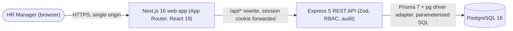
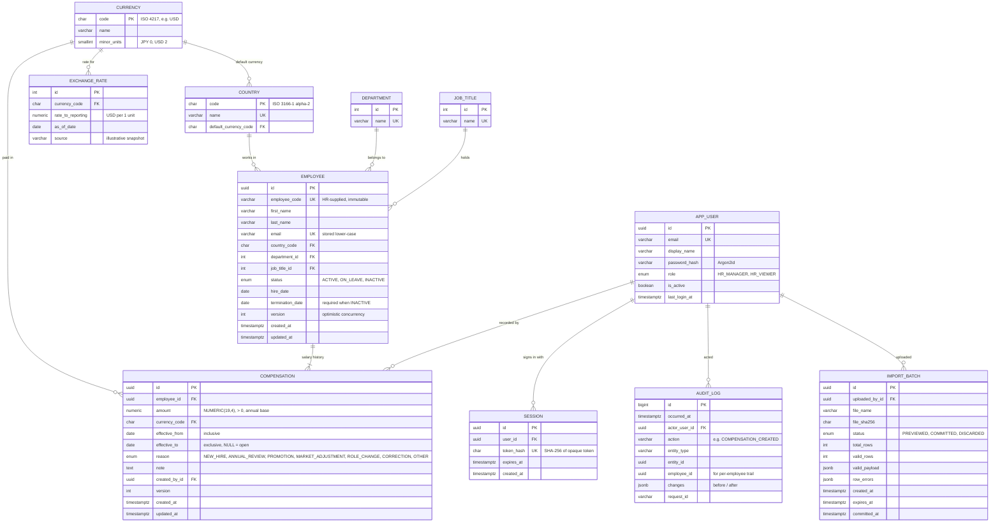
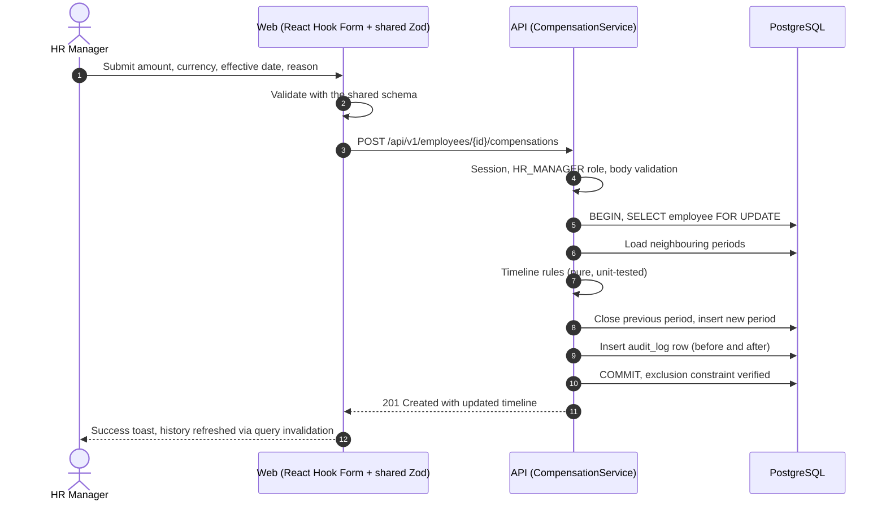
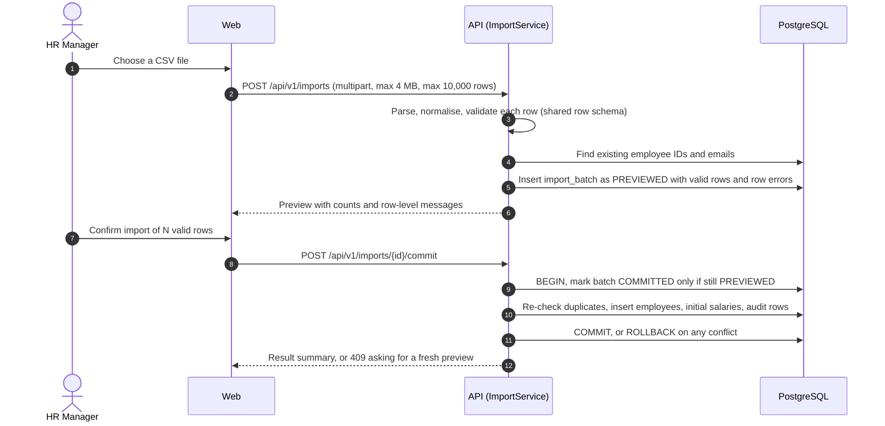

# Architecture

**Status:** Proposed (Phase 1) · Decisions are recorded in [adr/](./adr/) · Requirements are in [requirements.md](./requirements.md)

## 1. System context



The browser only talks to the web origin. Next.js forwards `/api/*` to the Express API, so the session cookie stays first-party. That avoids cross-site cookie blocking and keeps CSRF handling simple ([ADR-0001](./adr/0001-same-origin-api-and-cookie-sessions.md)). The API is the trust boundary: it enforces authentication, authorization, validation, business rules and auditing. The web app's own route guard only exists so users are redirected smoothly.

## 2. Technology and version pins

These versions were checked against the npm registry on 2026-11-19. Some newer versions are deliberately avoided:

| Concern | Choice | Notes |
|---|---|---|
| Runtime | Node.js **26 LTS** | Local is 26.13. Corepack isn't bundled from Node 25 onwards, so this repo uses **npm workspaces** rather than pnpm, which means no extra install for reviewers. |
| Web | Next.js 16.4, React 19.3, Tailwind CSS 4.3, shadcn/ui (Radix primitives) | |
| Data UI | TanStack Query 5, TanStack Table **8.21**, Recharts 3, React Hook Form 7 + Zod 4 | Table v9 only went stable in Aug 2026, and the shadcn data-table patterns target v8. Our table logic is thin because sorting and paging happen on the server. |
| API | Express 5.3, Zod 4, helmet, express-rate-limit, pino, @node-rs/argon2 | |
| Database | PostgreSQL 18, Prisma **7.10** (not 8) | npm's `latest` tag for `prisma` points to `8.0.0-rc.34`, which is a release candidate. The version is pinned so installs stay on stable 7.x. |
| Language | TypeScript **5.9** with `strict` on | TS 7.0 is out, but typescript-eslint supports `<6.1`. |
| Tests | Vitest 5, React Testing Library, Supertest, Playwright 1.65 | |
| Local DB | embedded-postgres (PostgreSQL 18 binaries from npm) | Docker isn't required ([ADR-0005](./adr/0005-zero-install-postgres-and-real-database-tests.md)). |

## 3. Repository layout (npm workspaces)

```text
apps/api/            Express API, Prisma schema, migrations, seed
  src/modules/       auth · employees · compensation · analytics · imports · exports · audit · reference
  src/domain/        pure business rules (salary timeline, money, CSV rows), no I/O
  src/http/          middleware: request id, auth, RBAC, validation, origin check, problem+json errors
apps/web/            Next.js App Router UI
  src/app/           (auth)/login · (app)/dashboard · employees · employees/[id] · analytics · imports
  src/features/      feature components and hooks; src/components/ui = shadcn primitives
packages/shared/     Zod schemas, DTO types, enums, money helpers shared by web and api
e2e/                 Playwright specs that span both apps
docs/                requirements, architecture, ADRs, plan, performance, AI log, demo script
```

`packages/shared` holds the request schemas, and both the API (to validate requests) and the forms (to validate client-side) use them. That means client and server rules can't drift apart.

## 4. Backend design

**Layers.** HTTP routes parse and validate, then call services. Services hold business rules and own transactions. Repositories run the Prisma and SQL queries. Rules that carry real risk, such as the salary timeline, money scale and CSV row validation, are pure functions in `src/domain` and are written test-first. Services are classes. They receive their dependencies (Prisma client, `Clock`, `AuditWriter`) through the constructor, and a small composition root wires them together. There's no DI container. The injected `Clock` keeps date-dependent tests deterministic.

**Errors.** One error middleware turns domain errors into [RFC 9457](https://www.rfc-editor.org/rfc/rfc9457) `application/problem+json` responses (`type`, `title`, `status`, `detail`, `requestId`, plus `errors[]` for field problems). Stack traces and SQL never reach clients.

| Code | When it's used |
|---|---|
| 400 | Malformed or invalid request |
| 401 / 403 | Not authenticated / role not allowed |
| 404 | Record not found |
| 409 | A conflict: duplicate employee ID or email, a stale `version`, or a timeline clash |
| 413 | Upload too large |
| 422 | A business rule was broken, such as an effective date before the hire date |
| 429 | Rate-limited |

**Concurrency.** Mutable rows carry a `version` column, and updates must send the version they read. A stale version returns 409, so two HR managers can't silently overwrite each other. Salary writes lock the employee row (`SELECT … FOR UPDATE`) for the whole transaction, and a database constraint is the final backstop ([ADR-0003](./adr/0003-salary-history-as-db-guarded-timeline.md)).

**Logging.** pino writes JSON logs, and each request carries a request ID. Salary amounts, passwords, cookies and auth headers are redacted.

## 5. Data model



**Integrity rules.** Some of these are written as custom SQL inside the Prisma migrations because Prisma's schema language can't express them.

- `compensation`:
  - `EXCLUDE USING gist (employee_id WITH =, daterange(effective_from, effective_to, '[)') WITH &&) DEFERRABLE INITIALLY DEFERRED` (needs the `btree_gist` extension), so no two salary periods for one employee can overlap.
  - `UNIQUE (employee_id, effective_from)`, `CHECK (amount > 0)` and `CHECK (effective_to IS NULL OR effective_to > effective_from)`.
- `employee`:
  - `CHECK (termination_date IS NULL OR termination_date >= hire_date)`, `CHECK (status <> 'INACTIVE' OR termination_date IS NOT NULL)`.
  - Foreign keys use `ON DELETE RESTRICT`, because employees are deactivated, never deleted.
  - The service also checks that `hire_date` is on or before the employee's earliest `effective_from`. This rule spans two tables, so it can't be a CHECK constraint.
- `audit_log`: a trigger rejects `UPDATE` and `DELETE`, so the table is append-only. Audit rows are written in the **same transaction** as the change they describe.
- `exchange_rate`: `UNIQUE (currency_code, as_of_date)`.

**Indexes, chosen from actual query patterns.** Every index below will be checked with `EXPLAIN ANALYZE` and recorded in `performance.md`.

| Query | Index |
|---|---|
| Search by name or employee ID (`ILIKE '%term%'`) | `pg_trgm` GIN on `first_name`, `last_name` and `employee_code` |
| Filters | B-tree on `country_code`, `department_id`, `job_title_id` and `status` (PostgreSQL combines them with bitmap AND) |
| Default sort | `(last_name, first_name, id)`, with `id` as a deterministic tiebreak |
| Sort by hire date | `(hire_date, id)` |
| Salary history and as-of lookup | `UNIQUE (employee_id, effective_from)` plus the exclusion constraint's GiST index |
| Recent salary changes (new periods and corrections) | `audit_log (entity_type, occurred_at DESC)`. The feed comes from audit events, so a correction to an old period still shows up. |
| Audit trail | `audit_log (employee_id, occurred_at DESC)` |
| Session lookup | `session (token_hash)` unique; `(expires_at)` for cleanup |

"Current salary" means the row where `effective_from <= :asOf AND (effective_to IS NULL OR effective_to > :asOf)`. It's never a stored flag, because a flag would go stale once a future-dated change takes effect.

## 6. Key flows

### Salary change



**Inserting a change.** A change can be inserted anywhere in the timeline, including before an already scheduled future raise. The previous period is shortened, and the new period ends where the next one begins.

**Correcting a period:**
- Corrections can edit amount, currency, reason and note on any period, and they must send the `version` they read.
- `effective_from` can only move strictly between its neighbours' start dates (and never before the hire date). In the same locked transaction, the **previous period's `effective_to` moves with it**, so the change creates neither an overlap nor a gap.
- Every row that changes gets its `version` incremented and its own audit entry.

**Gaps and deletion:**
- Periods have no gaps between them. Time between hire and the first period just means earlier history isn't known (common for imported spreadsheets).
- History rows are never deleted.

### CSV import (preview, then commit)



- **Idempotency.** The batch moves from `PREVIEWED` to `COMMITTED` with a guarded `UPDATE`. A double-click or a retry therefore finds the batch already committed, and nothing is imported twice.
- **Stale previews.** Previews expire after 30 minutes. If another user created a conflicting employee after the preview, the whole commit rolls back with a clear message.
- **Row rules.** Imports create new employees with their initial salary.
  - Rows that duplicate each other within the file, or that match existing employee IDs or emails, are reported and skipped.
  - Amounts must be plain decimals. Thousands separators get a friendly error instead of being guessed at.
  - A UTF-8 BOM and CRLF line endings are accepted.
- **Size limits.** The 4 MB limit keeps uploads under Vercel's 4.5 MB request-body cap.
- **Export safety.** Exports neutralise cells that start with `=`, `+`, `-`, `@`, tab or CR, so spreadsheets can't run them as formulas.

## 7. API surface (`/api/v1`, JSON, `problem+json` errors)

| Method and path | Purpose | Minimum role |
|---|---|---|
| `POST /auth/login` · `POST /auth/logout` · `GET /auth/me` | Session lifecycle; login is rate-limited | public / any / any |
| `GET /reference-data` | Countries, currencies, departments, job titles, statuses | viewer |
| `GET /employees` | `search`, `country`, `department`, `jobTitle`, `status`, `sort`, `order`, `page`, `pageSize` (≤ 100) | viewer |
| `POST /employees` | Create an employee and initial salary in one transaction | manager |
| `GET /employees/{id}` · `PATCH /employees/{id}` | Profile with current salary / edit (requires `version`) | viewer / manager |
| `POST /employees/{id}/deactivate` · `/reactivate` | Deactivate with termination date and reason. Reactivate **undoes a mistaken deactivation** (it clears the termination date). Rehiring is out of scope. Both are audited. | manager |
| `GET /employees/{id}/compensations` · `POST …` · `PATCH …/{compensationId}` | History / add change / correct | viewer / manager / manager |
| `GET /employees/{id}/audit-events` | Audit trail for that employee | viewer |
| `GET /analytics/summary` · `/distribution` · `/histogram` · `/trends` · `/recent-changes` | Dashboard and analytics. `dimension=country,department,jobTitle`; `currencyMode=local,normalized` | viewer |
| `POST /imports` · `GET /imports/{id}` · `POST /imports/{id}/commit` | CSV preview and commit | manager |
| `GET /exports/employees.csv` | Filtered export, streamed and audited | manager |
| `GET /health` | Liveness and database readiness | public |

List responses look like `{ data, page, pageSize, total, totalPages }`. Money is always sent as `{ amount: "125000.00", currency: "USD" }` ([ADR-0002](./adr/0002-money-and-multi-currency-analytics.md)).

Pagination is offset-based. With 10,000 rows, even the deepest `OFFSET` scan costs milliseconds, and HR users expect page numbers. Keyset pagination would only pay off at much larger scale.

## 8. Analytics

Analytics are computed on read in PostgreSQL using parameterised `$queryRaw` tagged templates: `avg`, `min`/`max`, `count`, `width_bucket` for histograms and `generate_series` for monthly trends ([ADR-0004](./adr/0004-analytics-in-sql-without-cache.md)).

- **Median.** Computed **exactly in `NUMERIC`**: the average of the middle row, or of the two middle rows, by `row_number()`. `percentile_cont` was ruled out because it returns `double precision` even for `NUMERIC` input (verified on PostgreSQL 18.6).
- **Quartiles.** Box-plot quartiles use `percentile_disc`, which keeps `NUMERIC` and returns real salaries.

- **Inputs and populations.** Every query takes an `asOf` date, and every figure names its population:
  - **Employee records** (all statuses) feed the status breakdown, including `INACTIVE`.
  - **Employed headcount** means `hire_date <= asOf` and no termination on or before `asOf`.
  - **Salary statistics** use employed people who have a salary period covering `asOf`.
- **Local mode (default).** Results are grouped by currency as well as the dimension, for example Engineering with USD, then Engineering with INR. Money in different currencies is never added together.
- **Normalised mode.** Amounts are converted to USD in SQL `NUMERIC` using the latest `exchange_rate` snapshot on or before `asOf`. Rounding happens once, at the end. Every normalised figure is shown next to its snapshot date and an "illustrative rates" label.
- **Trends.** The population for each month-end is worked out **at that date** from hire and termination dates, not from today's status. People who have since left are still counted in the months they worked.
  - The trend uses one FX snapshot for all months, so it shows real pay movement without FX noise.
  - Country, department and job title come from the employee's **current** assignment, because past assignments aren't stored. Trends split by those dimensions are labelled "by current organisation".
  - The UI states both of these points.
- **Small groups.** Groups with fewer than 5 employees get a `smallSample` flag, so the UI can warn that the median isn't representative.
- **Validation.** Raw-SQL results are parsed with Zod at the repository boundary, and integration tests compare them with values computed by hand from a small fixture dataset.

## 9. Frontend design

- **State ownership:**
  - **URL search params** hold list filters, sort and page, so a view can be shared and back/forward works.
  - **TanStack Query** holds server state. Query keys come from the filters, each request gets an `AbortSignal` so stale requests are cancelled, and `placeholderData` keeps the previous page on screen while the next loads, so the table doesn't flash.
  - **React Hook Form with the shared Zod schemas** holds form state.
  - **`useState`** holds local UI state.
  - There's no global client store because nothing needs one.
- **Search** waits 300 ms after typing stops and resets to page 1 when filters change.
- **Mutations:**
  - Salary writes aren't optimistic, because the server works out the neighbouring periods. The UI shows a pending state, disables the submit button, then invalidates the affected queries.
  - A 409 shows a "this record changed, reload" message.
- **Design system:**
  - Tailwind v4 tokens are set in CSS with `@theme`. The palette is restrained: slate neutrals, one brand accent, and semantic success, warning and danger colours, all checked for AA contrast.
  - Money columns use tabular numbers and are right-aligned.
  - On mobile the filters move into a sheet and the table scrolls horizontally with the first column pinned.
  - `Intl.NumberFormat` formats money from decimal strings, so no float conversion happens.
- **Accessibility:**
  - shadcn/Radix provides focus-trapped dialogs and dropdowns that work with the keyboard. Form labels are visible, and errors are linked with `aria-describedby`.
  - Toasts and table updates announce through `aria-live`. A "skip to content" link is provided.
  - Every chart has a "view as table" option.
  - Playwright runs axe checks on the key pages.

## 10. Security model

| Threat | Control |
|---|---|
| Credential stuffing or brute-force logins | Login is rate-limited by IP and email. The error message is always the same, and a dummy hash runs when the user doesn't exist, so response timing doesn't reveal which emails exist. Passwords use Argon2id with OWASP parameters. |
| Session theft through XSS | The opaque token lives in an `HttpOnly` cookie, never `localStorage`. Pages send a CSP and security headers. React escapes output by default. |
| CSRF | `SameSite=Lax` cookies, plus an `Origin` check on unsafe methods. Bodies must be JSON, except the import upload. |
| Privilege escalation | Role checks run on every API route, and integration tests cover allow and deny cases for each role. |
| Injection | Zod validates every body, query and path parameter. Prisma queries are parameterised, and raw SQL is written only as tagged templates. |
| Spreadsheet formula injection | Exported cells that start with formula characters are neutralised. |
| Data exposure | `Cache-Control: no-store` on all API responses. Logs are redacted, and errors don't leak internals. Seed data is synthetic only. |
| Tampering with history | No delete endpoints for salary records. The audit log is append-only, enforced by a trigger, and written in the same transaction as the change. |
| Abuse of uploads | 4 MB and 10,000-row limits. File content is parsed and validated rather than trusted by its MIME type. Rate limits apply. |

This is a reasonable baseline for an assessment, **not** a claim of production compliance. Anything handling real salary data would need an independent security review, encryption-at-rest decisions, secrets management, retention policies and MFA or SSO.

## 11. Testing strategy

| Layer | Tooling | Focus | Runs against |
|---|---|---|---|
| Domain unit | Vitest | Salary timeline rules, money parsing and scale per currency, CSV row validation, formula escaping, query parsing | Pure functions, written test-first |
| API integration | Vitest + Supertest | Every route: 401/403 per role, validation, CRUD, search/filter/sort/pagination, salary transactions and constraint mapping, audit rows, import atomicity and idempotency, analytics checked against hand-computed fixtures | **Real PostgreSQL** in a dedicated test database, with tables truncated between tests. No ORM mocks, because the database constraints are what's being tested. |
| Web component | Vitest + React Testing Library | Form validation messages, table sort and filter syncing to the URL and queries, debounce, loading, empty and error states | Network mocked at the `fetch` boundary |
| End to end | Playwright | Login, employee search, create employee, salary change, viewing salary history, plus axe accessibility checks | The full stack with seeded data |

Tests that depend on dates inject a `Clock`, and seed data is generated from a fixed date and a seeded random number generator, so test runs are repeatable.

## 12. Environments

| Environment | How | Verified by |
|---|---|---|
| Local, default (no Docker) | `npm run setup` starts embedded PostgreSQL 18 on port 54329 (data in `.data/`, git-ignored), creates the dev and test databases, migrates and seeds. `npm run dev` starts the API on :4000 and the web app on :3000. | Running it on this Mac (macOS arm64) |
| Docker Compose | `postgres:18-alpine` + `api` + `web` with a one-off migrate-and-seed service: `docker compose up --build` | CI only. Docker isn't installed on the development machine, and this is stated honestly in the docs. |
| CI (GitHub Actions) | Lint, typecheck and unit tests. A **reviewer-path job** on Ubuntu, macOS and Windows does a clean `npm ci`, `npm run setup` against embedded PostgreSQL, then the integration tests. Playwright. Docker build and a compose smoke test. | First run happens after you approve pushing to GitHub |
| Deployment (secondary) | Vercel hosts the web app and the API (as a Vercel Function), with Neon Postgres from the Vercel Marketplace | Needs Rohit's Vercel account. No URL is claimed until it has been deployed and checked. |

**Deployment caveats to resolve in the deployment phase:**
- The in-memory rate limiter works per instance on serverless, so it needs a Postgres-backed store.
- The request-body cap is 4.5 MB, which the 4 MB upload limit already allows for.
- Expect cold starts.
- Next.js `rewrites` capture the API origin at build time.

## 13. Risks to verify early

1. **Prisma and custom SQL.** Prisma ignores exclusion constraints and triggers, so a clean `prisma migrate diff` **can't** prove they still exist. Instead, integration tests check PostgreSQL's catalog (`pg_constraint` with `contype = 'x'`, `pg_trigger`, `pg_extension`). Behaviour tests also confirm that an overlap is rejected at commit and that `UPDATE` or `DELETE` on `audit_log` is rejected. These run after every migration.
2. **embedded-postgres on all platforms.** The npm package's versions are labelled beta, so the exact version is pinned. It's verified on macOS arm64 during design, and the CI reviewer-path matrix covers Ubuntu, macOS and Windows. Docker Compose is the fallback.
3. **Client IP behind the Next.js proxy.** Check `trust proxy` and `X-Forwarded-For` handling, so rate limiting uses the real client IP.
4. **Search wildcards.** Check that `%` and `_` typed into search are escaped and treated as literal characters.
5. **TanStack Table 8 with React 19.3.** Smoke-test early.
6. **Rewrite origin baked in at build time.** If deployment needs the API origin at runtime, fall back to a route-handler proxy.
